# Componentes

Catálogo de componentes eléctricos que ofrece la paleta del editor: cómo se dibuja cada uno, qué código tiene, cómo se llama y qué bornes expone.

## De dónde sale esto

- **Los dibujos** salen del mismo `shapes(w, h)` que usa el lienzo (`app/src/symbols/families.ts`) y se escriben como SVG sueltos en `docs/img/componentes/`. Si cambia el símbolo en la app, cambia la miniatura.
- **Los códigos y nombres** vienen de `app/src/symbols/catalog.ts`, generado desde el menú real del binario CADe_SIMU con `pnpm catalog` (`app/scripts/make-catalog.ts`). No están adivinados por rango numérico.
- **Los grupos y los nombres de familia** son los de la paleta (`app/src/ui/Palette.tsx`).
- **Los bornes** son una convención IEC elegida al dibujar cada símbolo, no un dato que venga en el archivo: el formato los guarda por registro y acá se listan los que la app asigna por defecto. En la miniatura se ven como círculos.

Totales: **270 códigos** en el catálogo generado, **235 componentes dibujados**, **47 códigos del catálogo caen al fallback** (un rectángulo con el código adentro).

Hay **3 componentes dibujados que no figuran en el catálogo**: `8016` (Lámpara de señalización), `8017` (Contacto del térmico), `8018` (Contacto auxiliar NC doble). No salen del menú del CAD pero aparecen en archivos reales, así que su plantilla se generó desde los fixtures y el dibujo se escribió a mano. Por eso no tienen designador de catálogo.

El designador de la tabla es el prefijo con el que el CAD nombra el componente nuevo (`-M`, `-Q`…); `—` significa que el catálogo no lo define.

De los 270 códigos, **125 no traen designador** en el catálogo: el menú del CAD no sugiere prefijo para esos componentes (alimentaciones, sensores y varios más).

## Convención de bornes

- **Aparatos de potencia:** 1-3-5 arriba, 2-4-6 abajo.
- **Contactos auxiliares:** 11-12 (NC), 13-14 (NA), 11-12-14 (conmutado).
- **Bobinas y temporizadores:** A1-A2.
- **Sensores de 2 hilos:** 1-2; de 3 hilos: `+`, `O`, `-`.

## Alimentación (15)

| Dibujo | Código | Nombre | Designador | Bornes |
| --- | --- | --- | --- | --- |
| 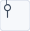 | `3000` | Alimentación L | — | — |
| 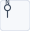 | `3001` | Alimentación N | — | — |
| 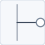 | `3002` | Alimentación PE | — | PE |
| 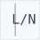 | `3003` | Alimentación L N | — | — |
| 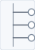 | `3004` | Alimentación L1 L2 L3 | — | L1 · L2 · L3 |
| 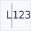 | `3005` | Alimentación L1 L2 L3 PE | — | — |
| 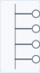 | `3006` | Alimentación L1 L2 L3 N | — | L1 · L2 · L3 · N |
| 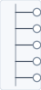 | `3007` | Alimentación L1 L2 L3 N PE | — | L1 · L2 · L3 · N · PE |
|  | `3008` | Alimentación + | — | + |
|  | `3009` | Alimentación - | — | — |
| 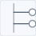 | `3010` | Alimentación + - | — | + · - |
|  | `3011` | Alimentación L N PE | — | — |
| 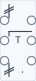 | `3012` | Transformador | `-T` | U1 · V1 · W1 · U2 · V2 · W2 |
| 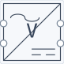 | `3013` | Rectificador | `-V` | ~ · ~ · + · - |
| 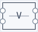 | `3014` | Fuente de alimentacióm | `-V` | L · N · + · - |

## Motores (9)

| Dibujo | Código | Nombre | Designador | Bornes |
| --- | --- | --- | --- | --- |
| 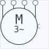 | `1000` | Motor trifásico | `-M` | U1 · V1 · W1 · PE |
|  | `1001` | Motor trifásico YD | `-M` | U1 · V1 · W1 · U2 · V2 · W2 |
|  | `1002` | Motor monofásico | `-M` | U1 · U2 |
|  | `1003` | Motor Dahlander | `-M` | U1 · V1 · W1 · U2 · V2 · W2 |
|  | `1004` | Motor rotor bobinado | `-M` | U1 · V1 · W1 · K · L · M |
|  | `1005` | Motor dos velocidades | `-M` | U1 · V1 · W1 · U2 · V2 · W2 |
| 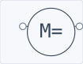 | `1006` | Motor cc. iman permanente | `-M` | A1 · A2 |
|  | `1007` | Motor cc. ex. indepen. | `-M` | A1 · A2 · E1 · E2 |
|  | `1010` | Motor trifásico como monofásico | `-M` | L · N |

## Potencia (15)

| Dibujo | Código | Nombre | Designador | Bornes |
| --- | --- | --- | --- | --- |
| 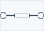 | `1050` | Resistencia I | `-R` | 1 · 2 |
| 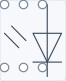 | `1051` | Resistencia III | `-R` | 1 · 2 · 3 · 4 · 5 · 6 |
| 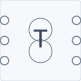 | `1052` | Autotransformador III | `-T` | U1 · V1 · W1 · U2 · V2 · W2 |
| 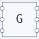 | `1053` | Arrancador electrónico | `-G` | 1 · 2 · 3 · 4 · 5 · 6 |
| 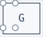 | `1054` | Variador velocidad ca II. | `-G` | 1 · 2 · 3 · 4 |
|  | `1055` | Variador velocidad ca III. | `-G` | 1 · 2 · 3 · 4 · 5 · 6 |
| 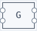 | `1057` | Variador velocidad cc. | `-G` | L+ · L- · M+ · M- |
|  | `1058` | Variador velocidad cc. | `-G` | L+ · L- · M+ · M- |
| 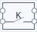 | `1076` | Relé 1 canal | `-K` | A1 · A2 · 11 · 14 |
| 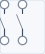 | `2000` | Contactor II | `-KM` | 1 · 2 · 3 · 4 |
| 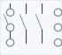 | `2001` | Contactor III | `-KM` | 1 · 3 · 5 · 2 · 4 · 6 |
| 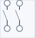 | `2003` | Interruptor II | `-S` | 1 · 2 · 3 · 4 |
| 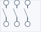 | `2004` | Interruptor III | `-S` | 1 · 2 · 3 · 4 · 5 · 6 |
| 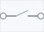 | `2006` | Contactor I | `-KM` | 1 · 2 |
|  | `2007` | Interruptor I | `-S` | 1 · 2 |

## Protección (33)

| Dibujo | Código | Nombre | Designador | Bornes |
| --- | --- | --- | --- | --- |
| 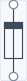 | `5000` | Fusible I | `-F` | 1 · 2 |
| 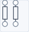 | `5001` | Fusible IN | `-F` | 1 · 2 · 3 · 4 |
|  | `5002` | Fusible II | `-F` | 1 · 2 · 3 · 4 |
| 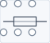 | `5003` | Fusible III | `-F` | 1 · 2 · 3 · 4 · 5 · 6 |
| 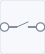 | `5005` | Seccionador I | `-F` | 1 · 2 |
|  | `5006` | Seccionador IN | `-F` | 1 · 2 · 3 · 4 |
| 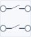 | `5007` | Seccionador II | `-F` | 1 · 2 · 3 · 4 |
| 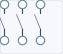 | `5008` | Seccionador III | `-F` | 1 · 2 · 3 · 4 · 5 · 6 |
| 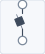 | `6000` | Automático I | `-F` | 1 · 2 |
|  | `6000` | Automático I | `-F` | 1 · 2 |
| 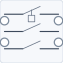 | `6001` | Automático IN | `-F` | 1 · 3 · 2 · 4 |
|  | `6001` | Automático IN | `-F` | 1 · 3 · 2 · 4 |
| 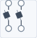 | `6002` | Automático II | `-F` | 1 · 3 · 2 · 4 |
|  | `6002` | Automático II | `-F` | 1 · 3 · 2 · 4 |
| 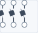 | `6003` | Automático III | `-F` | 1 · 3 · 5 · 2 · 4 · 6 |
|  | `6003` | Automático III | `-F` | 1 · 3 · 5 · 2 · 4 · 6 |
| 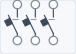 | `6004` | Automático IIIN | `-F` | 1 · 3 · 5 · 2 · 4 · 6 |
| 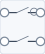 | `6005` | Diferencial IN | `-F` | 1 · 3 · 2 · 4 |
| 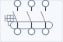 | `6006` | Diferencial IIIN | `-F` | 1 · 3 · 5 · 2 · 4 · 6 |
| 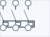 | `6007` | Relé térmico | `-F` | 1 · 3 · 5 · 2 · 4 · 6 |
|  | `6007` | Relé térmico | `-F` | 1 · 3 · 5 · 2 · 4 · 6 |
| 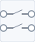 | `6008` | Disyuntor II | `-Q` | 1 · 3 · 2 · 4 |
|  | `6008` | Disyuntor II | `-Q` | 1 · 3 · 2 · 4 |
| 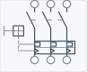 | `6009` | Disyuntor III | `-Q` | 1 · 3 · 5 · 2 · 4 · 6 |
|  | `6009` | Disyuntor III | `-Q` | 1 · 3 · 5 · 2 · 4 · 6 |
| 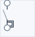 | `6010` | Disyuntor I | `-Q` | 1 · 2 |
|  | `6010` | Disyuntor I | `-Q` | 1 · 2 |
| 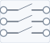 | `6015` | Contactor | `-Q` | 1 · 2 · 3 · 4 · 5 · 6 |
| 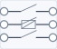 | `6016` | Relé térmico | `-F` | 1 · 2 · 3 · 4 · 5 · 6 |
| 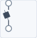 | `6017` | Interruptor automático | `-F` | 1 · 2 |
| 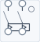 | `6018` | Interruptor diferencial | `-F` | 1 · 2 · 3 · 4 |
|  | `6019` | Interruptor | `-S` | 1 · 2 |
|  | `6020` | Interruptor | `-S` | 1 · 2 |

## Mando (48)

| Dibujo | Código | Nombre | Designador | Bornes |
| --- | --- | --- | --- | --- |
|  | `7000` | Contacto auxiliar NA | `-K` | 13 · 14 |
|  | `7001` | Contacto auxiliar NC | `-K` | 11 · 12 |
| 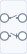 | `7002` | Contacto auxiliar NA-NC | `-K` | 13 · 11 · 14 · 12 |
| 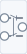 | `7003` | Contacto auxiliar conmutado | `-K` | 11 · 12 · 14 |
|  | `7004` | Contacto temporizador conexión NA | `-KA` | 13 · 14 |
|  | `7005` | Contacto temporizador conexión NC | `-KA` | 11 · 12 |
|  | `7006` | Contacto temporizador conexión NA-NC | `-KA` | 13 · 11 · 14 · 12 |
| 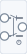 | `7007` | Contacto temporizador conexión conmutado | `-KA` | 11 · 12 · 14 |
|  | `7008` | Contacto temporizador desconexión NA | `-KA` | 13 · 14 |
|  | `7009` | Contacto temporizador desconexión NC | `-KA` | 11 · 12 |
|  | `7010` | Contacto temporizador desconexión NA-NC | `-KA` | 13 · 11 · 14 · 12 |
|  | `7011` | Contacto temporizador desconexión conmutado | `-KA` | 11 · 12 · 14 |
|  | `7012` | Contacto temporizador conexión desconexión NA | `-KA` | 13 · 14 |
|  | `7013` | Contacto temporizador conexión desconexión NC | `-KA` | 11 · 12 |
|  | `7014` | Contacto temporizador conexión desconexión NA-NC | `-KA` | 13 · 11 · 14 · 12 |
|  | `7015` | Contacto temporizador conexión desconexión conmutado | `-KA` | 11 · 12 · 14 |
|  | `7016` | Rele | `-KA` | A1 · A2 |
|  | `7018` | Contactor | `-KM` | A1 · A2 |
|  | `7019` | Contactos auxiliares | `-KM` | 13 · 11 · 14 · 12 |
|  | `7020` | Contactos ON Delay | `-KM` | 13 · 14 |
|  | `7021` | Contactos OFF Delay | `-KM` | 13 · 14 |
|  | `8000` | Contacto pulsador NA | `-S` | 13 · 14 |
|  | `8001` | Contacto pulsador NC | `-S` | 11 · 12 |
|  | `8012` | Contacto final de carrera NA | `-S` | 13 · 14 |
|  | `8013` | Contacto final de carrera NC | `-S` | 11 · 12 |
|  | `8016` | Lámpara de señalización | — | 97 · 98 |
|  | `8017` | Contacto del térmico | — | 95 · 96 |
|  | `8018` | Contacto auxiliar NC doble | — | 95 · 97 · 96 · 98 |
|  | `9000` | Bobina monoestable | `-EV` | A1 · A2 |
|  | `9001` | Bobina biestable | `-EV` | A1 · A2 |
|  | `9002` | Telerruptor | `-EV` | A1 · A2 · 1 · 2 |
|  | `9003` | Electroválvula | `-EV` | A1 · A2 |
|  | `9004` | Temporizador a la conexión | `-K` | A1 · A2 |
|  | `9005` | Temporizador a la desconexión | — | A1 · A2 |
|  | `9006` | Temporizador a la conexión desconexión | — | A1 · A2 |
|  | `9007` | Temporizador intermitente | `-K` | A1 · A2 |
|  | `10050` | Contacto NA | `-U` | 13 · 14 |
|  | `10051` | Contacto NC | — | 11 · 12 |
|  | `10500` | Actuador de simple efecto | `-A` | A |
|  | `10502` | Actuador sin vástago | `-A` | A |
|  | `10503` | Actuador sin vástago magnético | `-A` | A |
|  | `10504` | Actuador de doble efecto | `-A` | A · B |
|  | `10505` | Pinza neumática simple efecto | `-A` | A |
|  | `10506` | Pinza neumática | `-A` | A · B |
|  | `10507` | Ventosa | `-V` | A |
|  | `10508` | Motor neumático | `-M` | A |
|  | `10509` | Motor neumático reversible | `-M` | A · B |
|  | `10550` | Actuador lineal eléctrico | `-M` | A |

## Señalización y pulsadores (22)

| Dibujo | Código | Nombre | Designador | Bornes |
| --- | --- | --- | --- | --- |
|  | `8002` | Contacto pulsador NA-NC | `-S` | 13 · 11 · 14 · 12 |
|  | `8003` | Contacto pulsador conmutado | `-S` | 11 · 12 · 14 |
|  | `8004` | Contacto pulsador seta NA | `-S` | 13 · 14 |
|  | `8005` | Contacto pulsador seta NC | `-S` | 11 · 12 |
|  | `8006` | Contacto pulsador seta NA-NC | `-S` | 13 · 11 · 14 · 12 |
|  | `8007` | Contacto pulsador seta conmutado | `-S` | 11 · 12 · 14 |
|  | `8008` | Contacto interruptor NA | `-S` | 13 · 14 |
|  | `8009` | Contacto interruptor NC | `-S` | 11 · 12 |
|  | `8010` | Contacto interruptor NA-NC | `-S` | 13 · 11 · 14 · 12 |
|  | `8011` | Contacto interruptor conmutado | `-S` | 11 · 12 · 14 |
|  | `8014` | Contacto final de carrera NA-NC | `-S` | 13 · 11 · 14 · 12 |
|  | `8015` | Contacto final de carrera conmutado | `-S` | 11 · 12 · 14 |
|  | `8100` | Pulsador | `-S` | 13 · 14 |
|  | `8101` | Piloto | `-H` | X1 · X2 |
|  | `8103` | LED | `-H` | X1 · X2 |
|  | `9008` | Señalización óptica | `-H` | 97 · 98 |
|  | `9008` | Señalización óptica | `-H` | 97 · 98 |
|  | `9009` | Señalización óptica intermitente | — | X1 · X2 |
|  | `9010` | Timbre | — | X1 · X2 |
|  | `9011` | Zumbador | — | X1 · X2 |
|  | `9012` | Sirena | — | X1 · X2 |
|  | `9013` | Bocina | `-H` | X1 · X2 |

## Sensores (83)

| Dibujo | Código | Nombre | Designador | Bornes |
| --- | --- | --- | --- | --- |
|  | `7500` | Det. inductivo NA 2 hilos | — | 1 · 2 |
|  | `7501` | Det. inductivo NA 3 hilos PNP | — | + · O · - |
|  | `7502` | Det. inductivo NA 3 hilos NPN | — | + · O · - |
|  | `7503` | Det. inductivo NA 2 hilos | — | 1 · 2 |
|  | `7504` | Det. inductivo NA 3 hilos PNP | — | + · O · - |
|  | `7505` | Det. inductivo NA 3 hilos NPN | — | + · O · - |
|  | `7506` | Det. capacitivo NA 2 hilos | — | 1 · 2 |
|  | `7507` | Det. capacitivo NA 3 hilos PNP | — | + · O · - |
|  | `7508` | Det. capacitivo NA 3 hilos NPN | — | + · O · - |
|  | `7509` | Det. capacitivo NA 2 hilos | — | 1 · 2 |
|  | `7510` | Det. capacitivo NA 3 hilos PNP | — | + · O · - |
|  | `7511` | Det. capacitivo NA 3 hilos NPN | — | + · O · - |
|  | `7512` | Det. magnético NA 2 hilos | — | 1 · 2 |
|  | `7513` | Det. magnético NA 3 hilos PNP | — | + · O · - |
|  | `7514` | Det. magnético NA 3 hilos NPN | — | + · O · - |
|  | `7515` | Det. magnético NA 2 hilos | — | 1 · 2 |
|  | `7516` | Det. magnético NA 3 hilos PNP | — | + · O · - |
|  | `7517` | Det. magnético NA 3 hilos NPN | — | + · O · - |
|  | `7520` | Det. inductivo NC 2 hilos | — | 1 · 2 |
|  | `7521` | Det. inductivo NC 3 hilos PNP | — | + · O · - |
|  | `7522` | Det. inductivo NC 3 hilos NPN | — | + · O · - |
|  | `7523` | Det. inductivo NC 2 hilos | — | 1 · 2 |
|  | `7524` | Det. inductivo NC 3 hilos PNP | — | + · O · - |
|  | `7525` | Det. inductivo NC 3 hilos NPN | — | + · O · - |
|  | `7526` | Det. capacitivo NC 2 hilos | `-B` | 1 · 2 |
|  | `7527` | Det. capacitivo NC 3 hilos PNP | — | + · O · - |
|  | `7528` | Det. capacitivo NC 3 hilos NPN | — | + · O · - |
|  | `7529` | Det. capacitivo NC 2 hilos | — | 1 · 2 |
|  | `7530` | Det. capacitivo NC 3 hilos PNP | — | + · O · - |
|  | `7531` | Det. capacitivo NC 3 hilos NPN | — | + · O · - |
|  | `7532` | Det. magnético NC 2 hilos | `-B` | 1 · 2 |
|  | `7533` | Det. magnético NC 3 hilos PNP | — | + · O · - |
|  | `7534` | Det. magnético NC 3 hilos NPN | — | + · O · - |
|  | `7535` | Det. magnético NC 2 hilos | — | 1 · 2 |
|  | `7536` | Det. magnético NC 3 hilos PNP | — | + · O · - |
|  | `7537` | Det. magnético NC 3 hilos NPN | — | + · O · - |
|  | `7550` | Barrera fotoeléctrica reflex | `-B` | 1 · 2 |
|  | `7551` | Barrera foto. emisor | `-B` | 1 · 2 |
|  | `7552` | Barrera foto. emisor | — | 1 · 2 |
|  | `7553` | Barrera foto. receptor NA 2 hilos | `-B` | 1 · 2 |
|  | `7554` | Barrera foto. receptor NA 3 hilos PNP | — | + · O · - |
|  | `7555` | Barrera foto. receptor NA 3 hilos NPN | — | + · O · - |
|  | `7556` | Barrera foto. receptor NA 2 hilos | — | 1 · 2 |
|  | `7557` | Barrera foto. receptor NA 3 hilos PNP | — | + · O · - |
|  | `7558` | Barrera foto. receptor NA 3 hilos NPN | — | + · O · - |
|  | `7559` | Barrera foto. receptor NC 2 hilos | `-B` | 1 · 2 |
|  | `7560` | Barrera foto. receptor NC 3 hilos PNP | — | + · O · - |
|  | `7561` | Barrera foto. receptor NC 3 hilos NPN | — | + · O · - |
|  | `7562` | Barrera foto. receptor NC 2 hilos | — | 1 · 2 |
|  | `7563` | Barrera foto. receptor NC 3 hilos PNP | — | + · O · - |
|  | `7564` | Barrera foto. receptor NC 3 hilos NPN | — | + · O · - |
|  | `7570` | Presostato NA 2 hilos | `-B` | 1 · 2 |
|  | `7571` | Presostato NA 3 hilos PNP | — | + · O · - |
|  | `7572` | Presostato NA 3 hilos NPN | — | + · O · - |
|  | `7573` | Presostato NA 2 hilos | — | 1 · 2 |
|  | `7574` | Presostato NA 3 hilos PNP | — | + · O · - |
|  | `7575` | Presostato NA 3 hilos NPN | — | + · O · - |
|  | `7576` | Vacuostato NA 2 hilos | `-B` | 1 · 2 |
|  | `7577` | Vacuostato NA 3 hilos PNP | — | + · O · - |
|  | `7578` | Vacuostato NA 3 hilos NPN | — | + · O · - |
|  | `7579` | Vacuostato NA 2 hilos | — | 1 · 2 |
|  | `7580` | Vacuostato NA 3 hilos PNP | — | + · O · - |
|  | `7581` | Vacuostato NA 3 hilos NPN | — | + · O · - |
|  | `7582` | Presostato NC 2 hilos | `-B` | 1 · 2 |
|  | `7584` | Presostato NC 3 hilos NPN | — | + · O · - |
|  | `7585` | Presostato NC 2 hilos | — | 1 · 2 |
|  | `7586` | Presostato NC 3 hilos PNP | — | + · O · - |
|  | `7587` | Presostato NC 3 hilos NPN | — | + · O · - |
|  | `7588` | Vacuostato NC 2 hilos | `-B` | 1 · 2 |
|  | `7589` | Vacuostato NC 3 hilos PNP | — | + · O · - |
|  | `7590` | Vacuostato NC 3 hilos NPN | — | + · O · - |
|  | `7591` | Termostato NA 3 hilos PNP | — | + · O · - |
|  | `7592` | Vacuostato NC 3 hilos PNP | — | + · O · - |
|  | `7593` | Vacuostato NC 3 hilos NPN | — | + · O · - |
|  | `7594` | Termostato NA 3 hilos PNP | `-B` | + · O · - |
|  | `7595` | Termostato NA 3 hilos NPN | — | + · O · - |
|  | `7600` | Termostato NC 2 hilos | `-B` | 1 · 2 |
|  | `7601` | Termostato NC 3 hilos PNP | — | + · O · - |
|  | `7602` | Termostato NC 3 hilos NPN | — | + · O · - |
|  | `7603` | Termostato NC 2 hilos | — | 1 · 2 |
|  | `7604` | Termostato NC 3 hilos PNP | — | + · O · - |
|  | `7605` | Termostato NC 3 hilos NPN | — | + · O · - |
|  | `7883` | Presostato NC 3 hilos PNP | — | + · O · - |

## Líneas y cables (4)

| Dibujo | Código | Nombre | Designador | Bornes |
| --- | --- | --- | --- | --- |
|  | `4000` | Cable fase | — | — |
|  | `4009` | Cable neutro | — | — |
|  | `4010` | Cable PE | — | — |
|  | `4019` | Cable - | — | — |

## Borneras (6)

| Dibujo | Código | Nombre | Designador | Bornes |
| --- | --- | --- | --- | --- |
|  | `4011` | Regleta cuadrada | `-X` | 1 · 2 · 3 · 4 |
|  | `4012` | Regleta redonda | — | 1 · 2 · 3 · 4 |
|  | `4013` | Conector salida | — | 1 · 2 · 3 · 4 |
|  | `4014` | Conector entrada | — | 1 · 2 · 3 · 4 |
|  | `4015` | Regleta redonda 2 | — | 1 · 2 · 3 · 4 |
|  | `4016` | Regleta redonda 3 | — | 1 · 2 · 3 · 4 · 5 · 6 |

## Códigos sin símbolo dedicado (47)

No tienen dibujo propio: el lienzo los pinta con el fallback, un rectángulo con el código adentro y los bornes que declare el archivo. Siguen siendo válidos para abrir y guardar sin pérdida; lo que falta es el dibujo, así que no llevan miniatura acá.

Lo mismo pasa con cualquier código que no esté en el catálogo, por ejemplo `20000`, que aparece en el sample PR1: `resolveSymbol()` lo dibuja como `Genérico 20000` en lugar de romper el render.

| Código | Nombre | Designador |
| --- | --- | --- |
| `1059` | ControlVariador velocidad cc. | `-G` |
| `2002` | Contactor IIII | `-KM` |
| `2005` | Interruptor IIII | `-S` |
| `4001` | Conexión | — |
| `4002` | Manguera | — |
| `4003` | Entrada manguera | — |
| `4004` | Entrada manguera | — |
| `4017` | Regleta redonda 4 | `-X` |
| `4018` | Cable + | — |
| `5004` | Fusible IIIN | `-F` |
| `5009` | Seccionador IIIN | `-F` |
| `8102` | Botonera | `-H` |
| `10000` | Función lógica AND 2 | `-U` |
| `10001` | Función lógica AND 3 | — |
| `10002` | Función lógica AND 4 | — |
| `10003` | Función lógica AND 2 | — |
| `10010` | Función lógica OR 2 | `-U` |
| `10011` | Función lógica OR 3 | — |
| `10012` | Función lógica OR 4 | — |
| `10013` | Función lógica OR 2 | — |
| `10020` | Función lógica NAND 2 | `-U` |
| `10021` | Función lógica NAND 3 | — |
| `10022` | Función lógica NAND 4 | — |
| `10023` | Función lógica NAND 2 | — |
| `10030` | Función lógica NOR 2 | `-U` |
| `10031` | Función lógica NOR 3 | — |
| `10032` | Función lógica NOR 4 | — |
| `10033` | Función lógica NOR 2 | — |
| `10040` | Función lógica INV | `-U` |
| `10041` | Función lógica EXOR | `-U` |
| `10052` | Flanco ascendente | — |
| `10053` | Flanco descendente | `-U` |
| `10060` | Asignar | `-U` |
| `10061` | Set | — |
| `10062` | Asignar | `-U` |
| `10064` | Biestable RS | `-U` |
| `10065` | Bivisor Binario | `-U` |
| `10070` | Prueba | `-I` |
| `10071` | Visualiza | `-Q` |
| `10100` | Etapa 0 GRAFCET | — |
| `10101` | Etapa 0 GRAFCET | — |
| `10106` | Línea enlace GRAFCET | — |
| `10107` | Enlace de entrada GRAFCET | — |
| `10108` | Enlace de Salida GRAFCET | — |
| `10111` | Macro Etapa GRAFCET | — |
| `10112` | Etapa 0 GRAFCET | — |
| `10501` | Actuador de doble efecto | `-A` |

## Cómo mantenerlo

1. Regenerar tabla y dibujos: `pnpm componentes` (desde la raíz o desde `app/`). El script borra `docs/img/componentes/` y la rehace, así no quedan SVG huérfanos.
2. Si cambia el catálogo: correr `pnpm catalog` primero (necesita el binario en `data/`), después este script.
3. Cuando se agrega el dibujo de un código que estaba en fallback, sale de esa sección y aparece en su familia con su miniatura.
4. Un componente nuevo necesita dibujo y bornes en `src/symbols/families.ts` más su plantilla en `src/symbols/templates.ts`.
